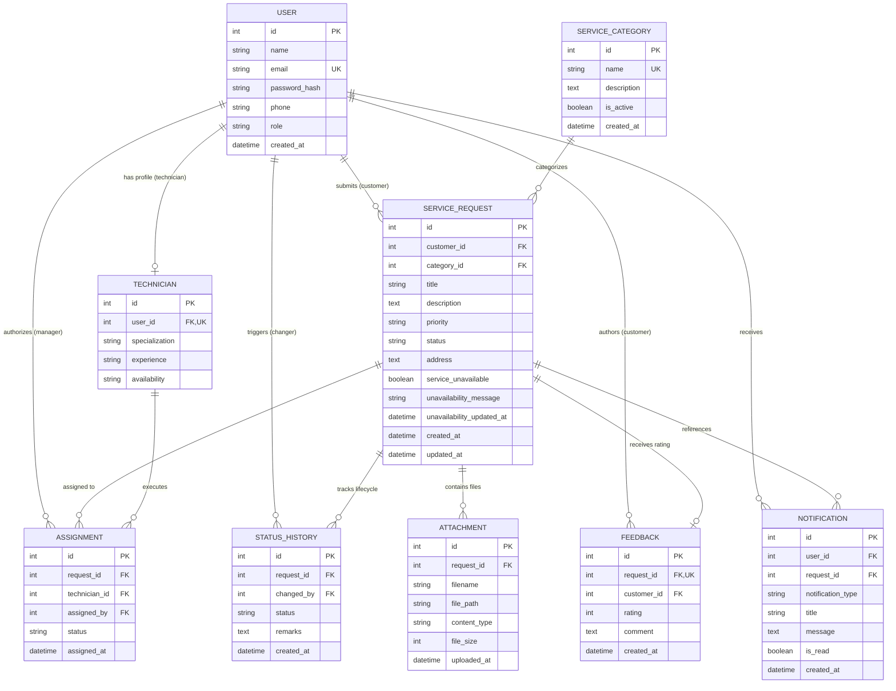

# Database Architecture & Data Model Documentation

## Service Request Management System

**Document Version:** 1.0  
**Source of Truth:** [PRD.md](file:///c:/Users/rajku/OneDrive/Desktop/Service%20Request/prd.md) & [ARCHITECTURE.md](file:///c:/Users/rajku/OneDrive/Desktop/Service%20Request/architecture.md)  
**ORM Framework:** SQLAlchemy 2.0 (declarative mapping)  
**Current Engine:** SQLite 3 (WAL mode) / PostgreSQL-ready  

---

## 1. Database Technology & Architecture

### 1.1 Technology Selection
The persistence layer is architected using **SQLAlchemy 2.0 ORM** over **SQLite 3** for development, local staging, and initial containerized deployments.

| Layer | Technology | Specification / Configuration |
| :--- | :--- | :--- |
| **RDBMS** | SQLite 3 | Embedded transactional SQL engine |
| **ORM / Query Builder** | SQLAlchemy | Version >= 2.0, Declarative Base |
| **Driver / Concurrency** | Python `sqlite3` | `connect_args={"check_same_thread": False}` |
| **Journal Mode** | WAL (Write-Ahead Logging) | `PRAGMA journal_mode=WAL; PRAGMA foreign_keys=ON;` |
| **Synchronous Mode** | NORMAL | Balances durability with write throughput |
| **Target Scale Engine** | PostgreSQL 16+ | Direct plug-in via `psycopg3` without ORM code rewrite |

### 1.2 Enterprise & Concurrency Rationale
- **Thread Safety:** Handled through scoped session factories (`sessionmaker(autocommit=False, autoflush=False)`) with explicit request-lifecycle session cleanup via FastAPI dependency injection (`get_db`).
- **Foreign Key Enforcement:** Explicitly activated using SQLite runtime PRAGMA hooks (`PRAGMA foreign_keys=ON;`) on connection connect.
- **Portability:** Data types and naming conventions utilize standard SQL-92 types (`INTEGER`, `VARCHAR`, `TEXT`, `BOOLEAN`, `DATETIME`) ensuring seamless migration to enterprise systems like PostgreSQL or MySQL when horizontal scaling is required.

---

## 2. Entity-Relationship (ER) Diagram



---

## 3. Comprehensive Schema & Table Definitions

### 3.1 `users` Table
Stores authenticated identity credentials, roles, and profile contacts.

| Column | Data Type | Nullable | Default | Constraints / Index | Description |
| :--- | :--- | :--- | :--- | :--- | :--- |
| `id` | `INTEGER` | NO | Auto-increment | `PRIMARY KEY` | Unique account identifier |
| `name` | `VARCHAR(100)` | NO | None | None | User's full legal/display name |
| `email` | `VARCHAR(255)`| NO | None | `UNIQUE`, Index | Normalized lowercase email address |
| `password_hash` | `VARCHAR(255)`| NO | None | None | Bcrypt hashed secret salt + digest |
| `phone` | `VARCHAR(20)` | YES | `NULL` | None | Primary contact telephone number |
| `role` | `VARCHAR(50)` | NO | None | Index | Role check: `CUSTOMER`, `MANAGER`, `TECHNICIAN` |
| `created_at` | `DATETIME` | NO | `UTC_TIMESTAMP` | None | Account registration timestamp |

**Indexes & Table-Level Constraints:**
- `ix_users_email`: B-tree index on `email` for O(1) login lookup.
- `ix_users_role`: Index on `role` for RBAC filtering.
- `unique_manager_idx`: Partial unique index `UNIQUE(role) WHERE role = 'MANAGER'` enforcing the strict single-manager business rule.

---

### 3.2 `technicians` Table
Extends the base user identity with operational field qualifications and dispatch metrics.

| Column | Data Type | Nullable | Default | Constraints / Index | Description |
| :--- | :--- | :--- | :--- | :--- | :--- |
| `id` | `INTEGER` | NO | Auto-increment | `PRIMARY KEY` | Unique technician record identifier |
| `user_id` | `INTEGER` | NO | None | `FOREIGN KEY(users.id)`, `UNIQUE` | 1-to-1 relationship to parent user |
| `specialization`| `VARCHAR(255)`| YES | `NULL` | None | Trade specialization (HVAC, Plumbing, Electrical) |
| `experience` | `VARCHAR(100)`| YES | `NULL` | None | Seniority level / field experience |
| `availability`| `VARCHAR(50)` | NO | `'Available'` | Index | Operational state: `Available`, `Busy`, `Off Duty` |

**Relationships:**
- `user`: Belongs to `User` via `user_id` (`ON DELETE CASCADE`).
- `assignments`: One-to-Many with `Assignment`.

---

### 3.3 `service_categories` Table
Service trade catalog classifying customer requests.

| Column | Data Type | Nullable | Default | Constraints / Index | Description |
| :--- | :--- | :--- | :--- | :--- | :--- |
| `id` | `INTEGER` | NO | Auto-increment | `PRIMARY KEY` | Category identifier |
| `name` | `VARCHAR(100)`| NO | None | `UNIQUE`, Index | Unique category name (e.g., Plumbing, HVAC) |
| `description` | `TEXT` | YES | `NULL` | None | Scope of work covered |
| `is_active` | `BOOLEAN` | NO | `TRUE` | None | Active dispatch status |
| `created_at` | `DATETIME` | NO | `UTC_TIMESTAMP` | None | Creation timestamp |

---

### 3.4 `service_requests` Table
Core transactional entity representing customer job tickets.

| Column | Data Type | Nullable | Default | Constraints / Index | Description |
| :--- | :--- | :--- | :--- | :--- | :--- |
| `id` | `INTEGER` | NO | Auto-increment | `PRIMARY KEY` | Unique service request ticket ID |
| `customer_id` | `INTEGER` | NO | None | `FOREIGN KEY(users.id)`, Index | Requester user ID |
| `category_id` | `INTEGER` | NO | None | `FOREIGN KEY(service_categories.id)`, Index | Category ID |
| `title` | `VARCHAR(255)`| NO | None | None | Issue headline |
| `description` | `TEXT` | NO | None | None | Comprehensive diagnostic description |
| `priority` | `VARCHAR(50)` | NO | `'Medium'` | None | Priority: `LOW`, `MEDIUM`, `HIGH`, `URGENT` |
| `status` | `VARCHAR(50)` | NO | `'Pending'` | Index | Status: `NEW`, `ASSIGNED`, `ACCEPTED`, `IN_PROGRESS`, `COMPLETED`, `CANCELLED` |
| `address` | `TEXT` | NO | None | None | Physical service location |
| `service_unavailable`| `BOOLEAN` | NO | `FALSE` | None | Manager flag indicating temporary unavailability |
| `unavailability_message`| `VARCHAR(255)`| YES | `NULL` | None | Exact message displayed to customer |
| `unavailability_updated_at`| `DATETIME` | YES | `NULL` | None | Timestamp when availability flag changed |
| `created_at` | `DATETIME` | NO | `UTC_TIMESTAMP` | Index | Ticket creation timestamp |
| `updated_at` | `DATETIME` | NO | `UTC_TIMESTAMP` | None | Last modification timestamp |

**Virtual Properties (Computed at runtime):**
- `customer_phone`: Exposed to technicians only upon reaching `ACCEPTED`, `IN_PROGRESS`, or `COMPLETED`.
- `technicians`: Resolves assigned technicians through the `assignments` junction.

---

### 3.5 `assignments` Table
Junction entity managing multi-technician assignments to service tickets.

| Column | Data Type | Nullable | Default | Constraints / Index | Description |
| :--- | :--- | :--- | :--- | :--- | :--- |
| `id` | `INTEGER` | NO | Auto-increment | `PRIMARY KEY` | Assignment record ID |
| `request_id` | `INTEGER` | NO | None | `FOREIGN KEY(service_requests.id)`, Index | Service ticket reference |
| `technician_id`| `INTEGER` | NO | None | `FOREIGN KEY(technicians.id)`, Index | Technician profile reference |
| `assigned_by` | `INTEGER` | NO | None | `FOREIGN KEY(users.id)` | Manager user ID who authorized dispatch |
| `assigned_at` | `DATETIME` | NO | `UTC_TIMESTAMP` | None | Dispatch authorization timestamp |
| `status` | `VARCHAR(50)` | NO | `'ASSIGNED'` | None | Assignment state: `ASSIGNED`, `ACCEPTED`, `IN_PROGRESS`, `COMPLETED` |

**Constraints:**
- Composite unique constraint `(request_id, technician_id)` prevents assigning the same technician multiple times to a single request.
- Maximum active technician assignments per request enforced at API/Service layer (<= 6 technicians).

---

### 3.6 `status_history` Table
Immutable audit log recording state transitions and actors.

| Column | Data Type | Nullable | Default | Constraints / Index | Description |
| :--- | :--- | :--- | :--- | :--- | :--- |
| `id` | `INTEGER` | NO | Auto-increment | `PRIMARY KEY` | Audit log record ID |
| `request_id` | `INTEGER` | NO | None | `FOREIGN KEY(service_requests.id)`, Index | Linked request |
| `status` | `VARCHAR(50)` | NO | None | None | Resulting status after transition |
| `changed_by` | `INTEGER` | NO | None | `FOREIGN KEY(users.id)` | User who executed transition |
| `remarks` | `TEXT` | YES | `NULL` | None | Optional transition notes / explanations |
| `created_at` | `DATETIME` | NO | `UTC_TIMESTAMP` | None | Event timestamp |

---

### 3.7 `feedback` Table
Post-service quality reviews submitted by customers.

| Column | Data Type | Nullable | Default | Constraints / Index | Description |
| :--- | :--- | :--- | :--- | :--- | :--- |
| `id` | `INTEGER` | NO | Auto-increment | `PRIMARY KEY` | Feedback identifier |
| `request_id` | `INTEGER` | NO | None | `FOREIGN KEY(service_requests.id)`, `UNIQUE` | 1-to-1 link: 1 review per ticket |
| `customer_id` | `INTEGER` | NO | None | `FOREIGN KEY(users.id)`, Index | Authorizing customer ID |
| `rating` | `INTEGER` | NO | None | `CHECK (rating BETWEEN 1 AND 5)` | 1 to 5 star rating score |
| `comment` | `TEXT` | YES | `NULL` | None | Qualitative customer review |
| `created_at` | `DATETIME` | NO | `UTC_TIMESTAMP` | None | Review submission timestamp |

---

### 3.8 `notifications` Table
In-app notification ledger for targeted alerts to customers, managers, and technicians.

| Column | Data Type | Nullable | Default | Constraints / Index | Description |
| :--- | :--- | :--- | :--- | :--- | :--- |
| `id` | `INTEGER` | NO | Auto-increment | `PRIMARY KEY` | Notification identifier |
| `user_id` | `INTEGER` | NO | None | `FOREIGN KEY(users.id)`, Index | Recipient user ID |
| `request_id` | `INTEGER` | YES | `NULL` | `FOREIGN KEY(service_requests.id)`, Index | Associated service ticket |
| `notification_type`| `VARCHAR(50)`| NO | `'GENERAL'` | None | Event classification: `TASK_ASSIGNED`, `STATUS_UPDATE`, `GENERAL` |
| `title` | `VARCHAR(255)`| NO | None | None | Alert summary heading |
| `message` | `TEXT` | NO | None | None | User-facing notification body |
| `is_read` | `BOOLEAN` | NO | `FALSE` | Index | Read/unread flag |
| `created_at` | `DATETIME` | NO | `UTC_TIMESTAMP` | Index | Generation timestamp |

---

### 3.9 `attachments` Table
File metadata linking uploaded images or diagnostic documents to service requests.

| Column | Data Type | Nullable | Default | Constraints / Index | Description |
| :--- | :--- | :--- | :--- | :--- | :--- |
| `id` | `INTEGER` | NO | Auto-increment | `PRIMARY KEY` | Attachment ID |
| `request_id` | `INTEGER` | NO | None | `FOREIGN KEY(service_requests.id)`, Index | Linked service request |
| `filename` | `VARCHAR(255)`| NO | None | None | Original uploaded file name |
| `file_path` | `VARCHAR(500)`| NO | None | None | Local filesystem or object storage path |
| `content_type`| `VARCHAR(100)`| NO | None | None | MIME type (e.g. `image/png`, `application/pdf`) |
| `file_size` | `INTEGER` | NO | None | None | Byte count (maximum 5MB limit) |
| `uploaded_at` | `DATETIME` | NO | `UTC_TIMESTAMP` | None | Upload timestamp |

---

## 4. Integrity Constraints & Business Logic Enforcement

### 4.1 Referential Integrity & Cascades
1. **Request Deletion:** Deleting a `ServiceRequest` cascades to associated `attachments`, `status_history`, and `feedback` records to prevent orphaned rows.
2. **User Integrity:** Technicians are tied 1:1 to their underlying `User` record via `user_id UNIQUE`. Deleting a technician profile purges the associated role record.

### 4.2 Temporal Business Constraints
- **Customer Edit & Delete Window:** Customers may only modify or delete requests within **20 minutes** of ticket creation (`now() - created_at <= 20 minutes`) and only when in `NEW` or `PENDING` status.
- **Assignment Delay Lock:** Managers cannot dispatch technicians until **30 minutes** after request creation (`now() - created_at >= 30 minutes`), allowing customers time to review, cancel, or amend tickets.

### 4.3 Capacity & Uniqueness Constraints
- **Maximum Active Technicians:** Enforced at <= 6 active technicians.
- **Single Manager Rule:** Enforced at database level via SQLite partial index `unique_manager_idx` on `users(role)` WHERE `role = 'MANAGER'`, preventing multiple manager accounts.
- **Idempotent Assignments:** Enforced via `(request_id, technician_id)` uniqueness in `assignments`.

---

## 5. Indexing Strategy & Real-World Query Workloads

All indexes have been created based on explicit query patterns observed in the backend services:

| Index Name | Table | Columns | Optimized Query Workflow |
| :--- | :--- | :--- | :--- |
| `ix_users_email` | `users` | `email` (UNIQUE) | Authentication login credential validation (`WHERE email = ?`) |
| `ix_users_role` | `users` | `role` | Technician profile queries, customer list filters |
| `unique_manager_idx` | `users` | `role` (Partial UNIQUE) | Server-side rejection of secondary manager registrations |
| `ix_service_requests_customer_id` | `service_requests` | `customer_id` | Customer "My Requests" dashboard (`WHERE customer_id = ? ORDER BY created_at DESC`) |
| `ix_service_requests_status` | `service_requests` | `status` | Filter by status on Manager & Technician dashboards |
| `ix_service_requests_category_id` | `service_requests` | `category_id` | Category filtering on manager request lists |
| `ix_assignments_request_id` | `assignments` | `request_id` | Joins for technician resolution per request |
| `ix_assignments_technician_id`| `assignments` | `technician_id` | Technician workload and assigned request queries |
| `ix_notifications_user_id` | `notifications` | `user_id`, `created_at` | Notification feed retrieval (`WHERE user_id = ? ORDER BY created_at DESC`) |
| `ix_notifications_request_id` | `notifications` | `request_id` | Querying notifications tied to specific service tasks |

---

## 6. Ownership, Authorization & Logical Row-Level Security (RLS)

While SQLite does not have native kernel-level RLS policies, **Logical Row-Level Security** is enforced strictly at the SQLAlchemy repository/service layer:

```text
┌────────────────────────────────────────────────────────────────────────┐
│                        DATA ACCESS CONTROL MATRIX                      │
├───────────────────┬──────────────┬──────────────────┬──────────────────┤
│ Entity            │ Customer     │ Technician       │ Manager          │
├───────────────────┼──────────────┼──────────────────┼──────────────────┤
│ Users             │ Self Only    │ Self Only        │ Read All         │
│ Service Requests  │ Own Only     │ Assigned Only    │ Read / Write All │
│ Technician Details│ Upon Accept  │ Self Only        │ Read All         │
│ Notifications     │ Own ID Only  │ Own ID Only      │ Own ID Only      │
│ Assignments       │ No Direct    │ Own ID Only      │ Create / Manage  │
│ Feedback          │ Own Request  │ Read on Assigned │ Read All / Stats │
└───────────────────┴──────────────┴──────────────────┴──────────────────┘
```

### 6.1 Security Rules in Code:
1. **Customer Request Isolation:** In [request_service.py](file:///c:/Users/rajku/OneDrive/Desktop/Service%20Request/backend/service_app/src/service_app/services/request_service.py), all customer queries strictly append:
   ```python
   query = query.filter(ServiceRequest.customer_id == current_user.id)
   ```
2. **Technician Assignment Verification:** A technician cannot inspect or advance the status of a request unless an explicit link exists in `assignments`:
   ```python
   assignment = db.query(Assignment).filter(
       Assignment.request_id == request_id,
       Assignment.technician_id == tech_profile.id
   ).first()
   if not assignment:
       raise HTTPException(status_code=403, detail="Not authorized to access this request.")
   ```
3. **Notification Privacy:** Users can only query notifications where `Notification.user_id == current_user.id`. The patch-as-read endpoint validates ownership before updating:
   ```python
   notification = db.query(Notification).filter(
       Notification.id == notification_id,
       Notification.user_id == current_user.id
   ).first()
   ```

---

## 7. Sensitive Data Handling & Privacy

1. **Authentication Secrets:**
   - Passwords are encrypted before storage using **Bcrypt** with dynamic work factors (`passlib.context.CryptContext(schemes=["bcrypt"], deprecated="auto")`).
   - Plaintext passwords and JWT bearer tokens are never persisted in the database.
2. **Contact Detail Privacy (PRD Rule FR-10):**
   - Customer phone number is hidden from technicians until the assignment status reaches `ACCEPTED`, `IN_PROGRESS`, or `COMPLETED`.
   - Technician contact details are shielded from customers while a ticket is `PENDING` or before explicit acceptance by the technician.
3. **File Upload Hardening:**
   - Attachments are stored on disk under `uploads/` using UUID-based sanitized file paths to prevent directory traversal attacks (`uuid.uuid4() + ext`).
   - Only file metadata (`filename`, `file_path`, `content_type`, `file_size`) is stored in the database.

---

## 8. Migration & Seeding Strategy

### 8.1 Schema Evolution Strategy
The application employs an idempotent non-destructive startup migration pattern implemented in [main.py](file:///c:/Users/rajku/OneDrive/Desktop/Service%20Request/backend/service_app/src/service_app/main.py#L12-L38):

1. **Table Creation:** `Base.metadata.create_all(bind=engine)` creates any newly defined tables.
2. **Safe Dynamic Alterations:** `init_db_migrations()` checks SQLite system catalog via `PRAGMA table_info` and executes non-destructive `ALTER TABLE ... ADD COLUMN` statements if columns are missing.
3. **Zero Data Loss Guarantee:** Existing records automatically receive safe defaults (`service_unavailable = 0`, `unavailability_message = NULL`, `notification_type = 'GENERAL'`) without dropping or recreating tables.

### 8.2 Seeding Reference Data
On initial deployment or testing, seed data is populated through:
- **Service Categories:**
  1. General Maintenance
  2. Plumbing
  3. Electrical
  4. Painting
  5. Carpentry
  6. Appliance Repair
  7. HVAC
  8. Cleaning
  9. Pest Control
  10. Other
- **Single Manager Account:** Initialized with hashed credential during setup.

---

## 9. Backup, Durability & Disaster Recovery

### 9.1 Storage Durability in Cloud Environments
- **SQLite Concurrency:** SQLite in WAL mode permits concurrent readers without blocking writers.
- **FastAPI Cloud Persistence:** The database file path is resolved to an absolute directory on the host (`base_dir / db_filename`) ensuring it is preserved in persistent volume mounts.
- **Online Hot Backups:** For production disaster recovery, hot backups can be taken without locking the application using SQLite's native VACUUM API:
  ```bash
  sqlite3 service_app.db "VACUUM INTO 'backup_service_app_$(date +%Y%m%d_%H%M%S).db'"
  ```

### 9.2 Recovery Metrics
- **Recovery Point Objective (RPO):** <= 1 hour with hourly WAL file snapshots.
- **Recovery Time Objective (RTO):** <= 5 minutes (simple file swap and service reload).
